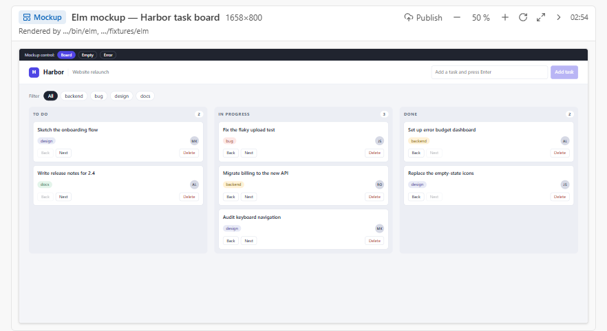
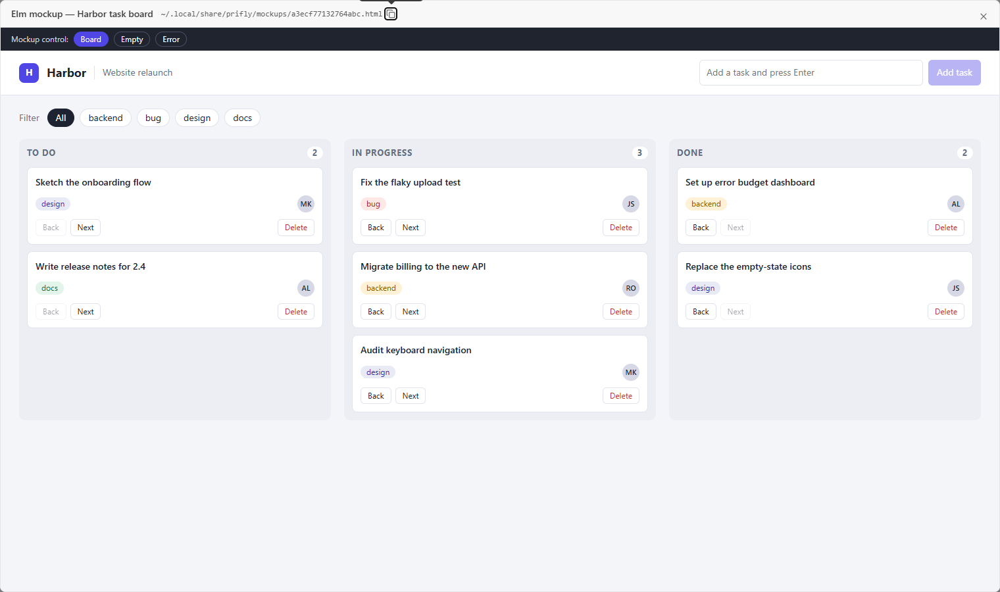

# prifly-mockup-elm

A mockup recipe for **Elm** web apps, for [prifly](https://github.com/jimmy927/prifly) sessions. When a session is asked
to mock up a screen of an Elm project, the recipe tells it how to compile the real app with the real `elm make`, pack
it into one self-contained HTML page and post it with `mcp__prifly__mockup`.

## Use it in prifly

prifly keeps shared recipe packs as git clones. Add this one in `~/.local/share/prifly/mockup-stacks/packs.json`:

```json
{ "packs": [{ "name": "prifly-mockup-elm", "url": "https://github.com/jimmy927/prifly-mockup-elm.git" }] }
```

or set `PRIFLY_MOCKUP_STACK_PACKS="https://github.com/jimmy927/prifly-mockup-elm.git"` in the host's environment. The
host pulls it in the background (at most once per `PRIFLY_MOCKUP_STACK_PULL_HOURS`, 24 by default) and
`mockup_recipe` then finds `elm` for any project with an `elm.json`. A recipe in the project's own
`.prifly/mockup-stacks/` or in the user folder wins over this pack.

## The recipe

`mockup-stacks/elm.md` says: install the official Elm 0.19.1 binary into `~/.cache/mockup-toolchains/elm` (no sudo),
compile the project with `elm make --optimize` to a JS file outside the checkout, inline it with the CSS into a host
page that calls `Elm.Main.init` (`Browser.element`; flags and a port carry the state from `location.hash`), set
`window.__mockupReady`, and post the one file (about 130 kB for the proof app). It lists what cost time (no
`Browser.application` in a file page, `--optimize` versus `Debug`, leaving no `elm-stuff/` behind) and how empty and
error states sit behind a mockup control outside the app frame. `mockup-stacks/fixtures/elm/` is the small proof
project, a task board; its `build.sh` rebuilds the page.

## Check

```
bun scripts/check.ts
```

validates every recipe's frontmatter against the schema prifly's loader uses. Inside a prifly checkout,
`bun run mockup-stacks:check --layer packs` also builds the fixture (needs `elm` on the PATH).

## Screenshots





## License

MIT, see [LICENSE](LICENSE).
